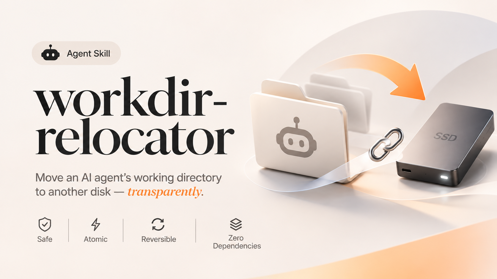

# workdir-relocator



> Move an AI agent / coding tool's working directory to another disk transparently.
> The original path stays as a symlink, so the application never notices.

**English** | [简体中文](README.zh-CN.md)

## Why

AI coding agents and chat clients keep growing: Claude Code, Cursor, Codex CLI,
Windsurf, Gemini CLI, and many others. They cache skills, sessions, projects, and
generated files on your system drive by default. When that disk is running out of
space, you want the bulk of the data to live on an external SSD or a second volume —
without changing every tool's settings, breaking logins, or reconfiguring your workflow.

`workdir-relocator` does one thing: it atomically copies a directory to the new disk,
swaps the original path for a symlink, and keeps everything transparent.

## Features

- **Transparent** — the original path becomes a symlink; apps keep using the old path.
- **Safe** — rsync with double verification, automatic rollback on any failure.
- **Race-condition aware** — apps that recreate the directory while running are handled
  with an atomic retry loop (up to 300 attempts).
- **Reversible** — a `<name>.old` backup is kept until you confirm everything works.
- **Idempotent** — refuses to run on an already-migrated directory.
- **Zero dependencies** — Python 3 standard library + `rsync` (preinstalled on macOS / Linux).

## Quick start

There are two ways to use it. Pick the one that fits your setup.

### Option A — Install as an agent Skill (recommended)

This project is packaged as a standard Skill that any AI agent can load.

1. Copy the whole folder into your agent's user-skills directory:

```bash
# Typical location on macOS / Linux:
cp -R workdir-relocator ~/.doubao/agent_mode/workspace/.user_skills/
# Other agents may use ~/.config/<agent>/skills/ or a similar path —
# check your agent's documentation for the exact directory.
```

2. Restart or reload the agent. It will discover the Skill from the `name` and
   `description` in `SKILL.md`.

3. Just ask in natural language, for example:

```text
"Move my ~/.claude directory to /Volumes/ExtSSD/cache."
"My system disk is full — relocate the Cursor cache to my external drive."
```

The agent will run the relocation script with a dry-run first, then execute after
you confirm the plan.

### Option B — Use as a standalone CLI

You can run the script directly without any agent.

```bash
# 1. Preview the plan (no changes made)
python3 scripts/relocate.py \
  --from ~/.claude \
  --to "/Volumes/ExtSSD/cache" \
  --dry-run

# 2. Run for real
python3 scripts/relocate.py \
  --from ~/.claude \
  --to "/Volumes/ExtSSD/cache"

# 3. Verify the app still works, then remove the backup
rm -rf ~/.claude.old
```

### CLI options

| Flag | Description |
|---|---|
| `--from <path>` | Directory to move (e.g. `~/.claude`, `~/.codex`). |
| `--to <path>` | Parent directory on the target disk. A new folder is created there. |
| `--name <name>` | Override the new directory name (defaults to the source folder name). |
| `--dry-run` | Pre-check + rsync preview only, no swap. |

## How it works

```
1. Preflight       source exists, target writable, disk space ≥ 1.2× source size,
                   current shell is not inside source
2. Copy            rsync -a --delete source/ → target/
3. Verify          rsync -a --delete --dry-run again → must show zero diff
4. Atomic swap     rename source → source.old (same-volume rename)
                   retry loop: clean app-recreated dir → symlink → target
5. Write probe     write a file through the old path, confirm it lands on target
6. Done            backup kept at source.old; rollback path documented
```

## Common directories to relocate

| Tool | Working directory (macOS) |
|---|---|
| Claude Code | `~/.claude/` |
| Codex CLI | `~/.codex/` |
| Gemini CLI | `~/.gemini/` |
| Cursor (cache) | `~/Library/Application Support/Cursor/` |
| Windsurf (cache) | `~/Library/Application Support/Windsurf/` |
| Doubao work | `~/Doubao` |

See [`references/agents.md`](references/agents.md) for the full table (Linux / Windows
included) and a pre-flight checklist.

## Caveats

- **Target disk must stay mounted.** If the external drive is unplugged, the old path
  becomes a dangling symlink and the tool cannot open its working directory. Plug it
  back in and everything works again.
- **Do not use exFAT / FAT32.** Symlinks and Unix permissions are not preserved on
  those filesystems. Use APFS (macOS), ext4 (Linux), or NTFS on Windows.
- **Quit the app first if possible.** The retry loop handles running apps, but a clean
  shutdown is safer.
- **Not for Windows.** This script uses POSIX symlinks and rsync. Windows needs
  `mklink /D` and is not supported yet.

## Rollback

If something looks wrong after migration:

```bash
rm ~/.claude                  # remove the symlink
mv ~/.claude.old ~/.claude    # restore the original directory
```

The script also rolls back automatically if any step fails mid-run.

## License

[MIT](LICENSE)
